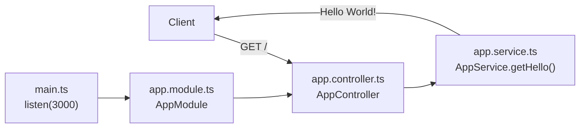

<div align="center">

# PAM

**PAM, PAM, PAM! Automatize your tasks :)**<br/>
A personal assistant API built with NestJS. Today it exposes a single `GET /` endpoint.

[](https://github.com/juninmd/pam-api/actions/workflows/validate.yml)
[](https://github.com/juninmd/pam-api/actions/workflows/security.yml)


[](package.json)

<br/>


</div>

## Description

This project is a personal assistant.

## Install

Requires Node.js and npm. The Node.js version is not pinned in the repository.

```bash
npm install   # install dependencies from package-lock.json
```

## Usage

Start the dev server, then call the endpoint:

```bash
npm run start:dev                  # watch mode on port 3000
curl http://localhost:3000/        # GET / returns the greeting
```

```text
Hello World!
```

## How it works



- `main.ts` bootstraps Nest from `AppModule` and listens on port 3000.
- The controller only routes the request; `AppService` holds the logic, so new behavior lands in the service.

## Develop

```bash
npm run start:dev    # dev server with watch mode
npm run start        # run once through nest start
npm run build        # compile to dist/ (removes dist/ first)
npm run start:prod   # run dist/main.js; run build first
npm run test         # unit tests (src/**/*.spec.ts)
npm run test:e2e     # end-to-end tests (test/**/*.e2e-spec.ts)
npm run test:cov     # unit tests with coverage report in coverage/
npm run lint         # ESLint; applies fixes in place
npm run format       # Prettier; rewrites src and test files
```

## Contributing

Repository guidelines for contributors and AI agents are in [AGENTS.md](AGENTS.md).

## Known limitations

- Only `GET /` exists. It returns the fixed string `Hello World!`.
- The port is hard-coded to `3000` in `src/main.ts`; the project reads no environment variables.
- No authentication or authorization on any endpoint.
- `package.json` has no `engines` field. Both `package-lock.json` and `yarn.lock` are committed; this README uses npm.

## License

MIT, as declared in `package.json`. The repository has no `LICENSE` file yet.
